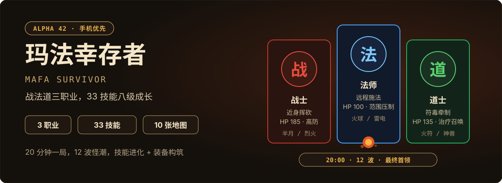
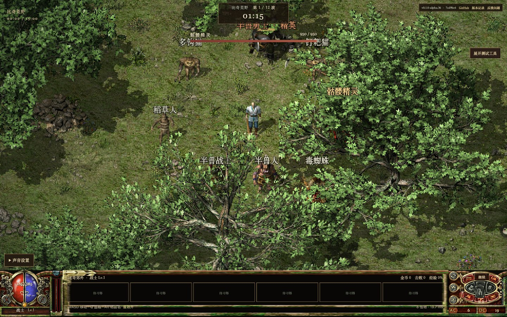
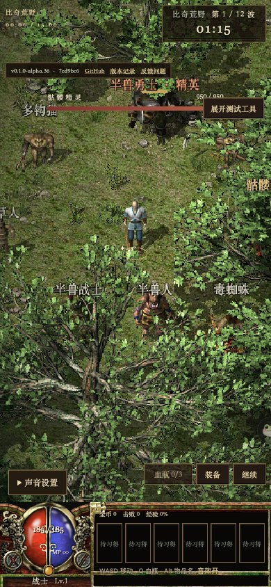

<p align="right"><a href="README.md">中文</a></p>

<p align="center">
  
</p>

<p align="center">
  <a href="https://xiaosang.cc/mafa-survivor/?survivor">▶ Play Online · Survivor Mode</a>
  ·
  <a href="https://xiaosang.cc/mafa-survivor/">Original Mode</a>
  ·
  <a href="https://github.com/holynova/mafa-survivor">GitHub Repository</a>
</p>

Mafa Survivor is a mobile-first browser survivor game: three classes (Warrior, Wizard, Taoist), 33 skills with 8 ranks of growth, 10 maps, skill evolutions and equipment builds. Each run lasts 20 minutes across 12 waves, ending with a final boss. Current version is v0.1.0-alpha.42 — still alpha: full class/chapter balance and device performance are unfinished.

## Screenshots

<p align="center">
  
  
</p>

> Screenshots are from alpha.36; the current version is alpha.42, so interface details may differ.

## How to Play

- **20 minutes a run**: 1200 seconds, 12 waves (one every 100 seconds); elites appear from minute 2, a boss arrives at minute 5, and the final boss comes in the last stage.
- **Three classes**: Wizard (100 HP, ranged casting and AoE suppression, starts with 火球术 Fireball), Taoist (135 HP, poison/control plus healing and summons, starts with 火符 Fire Talisman), Warrior (185 HP, melee slashes and tough breakthroughs, starts with 半月 Crescent Blade in survivor mode).
- **33 skills, 8 ranks**: ranks 1–6 are base growth, ranks 7–8 specialize per skill (e.g. 火球术 Fireball rank 7: +20% projectile speed; rank 8: up to 4 projectiles). The final rank only unlocks after rank 6 (from wave 6).
- **Skill evolutions (9 recipes)**: a skill at rank 8 + its matching charm + an evolution chest evolves it (e.g. 火球术 Fireball → 爆裂火球 Burst Fireball, exploding with splash on hit; 雷电术 Lightning → 雷霆连锁 Chain Lightning, jumping up to 4 enemies). Only chests dropped by elites/bosses after minute 8 can evolve; every 2 elite kills grants a chest, and stage bosses always drop one.
- **10 charms**: 火焰戒指 (Flame Ring), 锋锐戒指 (Sharp Ring), 灵魂项链 (Soul Necklace), 疾风项链 (Gale Necklace), 广域护符 (Wide Charm), 长生手镯 (Longevity Bracelet), 拾取护符 (Pickup Charm), 鹰眼戒指 (Eagle Eye Ring), 疾行靴 (Swift Boots), 回春戒指 (Rejuvenation Ring) — stat boosts that also serve as evolution ingredients.
- **10 maps**: chapters unlock out-of-run with 玛法水晶 (Mafa Crystals, 0–27), each with its own monster pool and boss.
- **Equipment builds**: in-run drops and shop gear, potions (red/blue potions, Sun Water), combined with skills and charms to complete a build.
- **Two modes**: survivor mode (`?survivor`) and the original mode, with separate saves; a fast test mode and test-tools panel are included.

## Maps

| Map | Boss | Unlock (Mafa Crystals) |
| :--- | :--- | :---: |
| 比奇郊外 (Biche Outskirts) | 半兽勇士 (Orc Brave) | 0 |
| 矿洞与骷髅洞 (Mine & Skeleton Cave) | 尸王 (Corpse King) | 3 |
| 沃玛神殿 (Woma Temple) | 沃玛教主 (Woma Lord) | 6 |
| 祖玛神殿 (Zuma Temple) | 祖玛教主 (Zuma Lord) | 9 |
| 盟重土城 (Mengzhong) | 霸王教主 (Overlord) | 12 |
| 蜈蚣洞 (Centipede Cave) | 触龙神 (Venomous Dragon God) | 15 |
| 石阁地宫 (Stone Pavilion) | 白野猪 (White Boar) | 18 |
| 赤月山谷 (Red Moon Valley) | 赤月恶魔 (Red Moon Demon) | 21 |
| 白日门 (White Sun Gate) | 赤月恶魔 (Red Moon Demon) | 24 |
| 石墓一层 (Stone Tomb 1F) | 白野猪 (White Boar) | 27 |

## Skills (33, by class)

- **Wizard (14)**: 火球术 (Fireball), 雷电术 (Lightning Bolt), 火墙 (Firewall), 魔法盾 (Magic Shield), 抗拒火环 (Repelling Flame Ring), 地狱火 (Hellfire), 大火球 (Greater Fireball), 瞬息移动 (Teleport), 爆裂火焰 (Burst Flame), 疾光电影 (Lightning Beam), 地狱雷光 (Hell Lightning), 圣言术 (Holy Word), 冰咆哮 (Ice Roar), 诱惑之光 (Enticing Light).
- **Warrior (6)**: 基本剑术 (Basic Swordsmanship), 攻杀剑术 (Slaying Swordsmanship), 刺杀剑术 (Thrusting Swordsmanship), 半月弯刀 (Crescent Blade), 野蛮冲撞 (Savage Charge), 烈火剑法 (Blazing Sword).
- **Taoist (13)**: 治愈术 (Healing), 精神力战法 (Spirit Swordsmanship), 施毒术 (Poisoning), 灵魂火符 (Soul Fire Talisman), 召唤骷髅 (Summon Skeleton), 隐身术 (Invisibility), 集体隐身术 (Mass Invisibility), 幽灵盾 (Ghost Shield), 神圣战甲术 (Sacred Armor), 心灵启示 (Mind Revelation), 困魔咒 (Demon Binding Curse), 群体治疗术 (Mass Healing), 召唤神兽 (Summon Divine Beast).

## Run Locally

Phaser + React + TypeScript + Vite; assets must be imported first (original Mir2 images, maps and WAV files, sources recorded):

```sh
npm ci
python3 -m venv .venv
.venv/bin/pip install -r tools/requirements.txt
.venv/bin/python tools/import-assets.py
npm run dev
```

Checks and tests: `npm test` (vitest), `npm run build` (type checking + build). See [docs/DEVELOPMENT.md](docs/DEVELOPMENT.md) for development notes, [docs/STATUS.md](docs/STATUS.md) for progress, and [docs/ACCEPTANCE.md](docs/ACCEPTANCE.md) for acceptance criteria.

## Tech

- Phaser 3.90 (game rendering) + React 19 (UI) + TypeScript 5.9 + Vite 7 + zod (data validation) + idb (saves).
- Numbers and content live in `src/content.ts` (maps / equipment / monsters), `src/spells.ts` (33 skill definitions), `src/skill-growth.ts` (ranks 1–6), `src/survivor-growth.ts` (ranks 7–8 specialization), `src/survivor-evolutions.ts` (9 evolution recipes).
- Assets: registered original Mir2 images, maps and WAV files (sources and project authorization in `docs/asset-authorization.json`; mir2x_res license in `docs/licenses/`).

```
index.html                  Entry
src/main.tsx                React entry
src/App.tsx                 Original mode app
src/SurvivorApp.tsx         Survivor mode app
src/game.ts                 Game core (combat / waves / saves)
src/renderer.ts             Phaser rendering
src/content.ts              Maps / equipment / monsters / numbers
src/spells.ts               33 skill definitions
src/skill-growth.ts         Skill ranks 1–6
src/survivor-growth.ts      Skill ranks 7–8 specialization
src/survivor-evolutions.ts  9 evolution recipes
src/survivor.ts             Survivor mode rules (20 min / 12 waves / elites & bosses)
src/classes.ts              Three class stats
tools/import-assets.py      Asset import script
```
