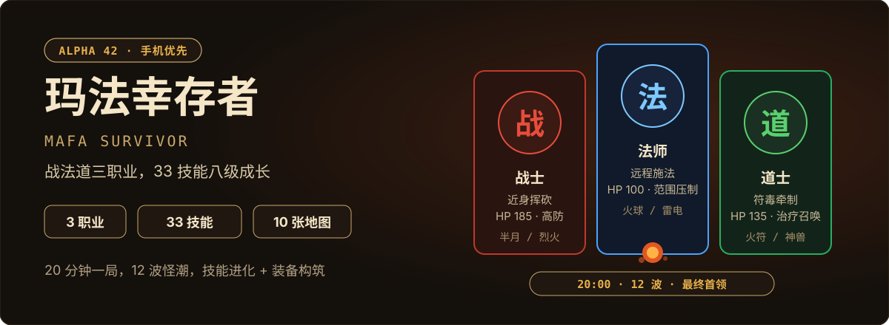
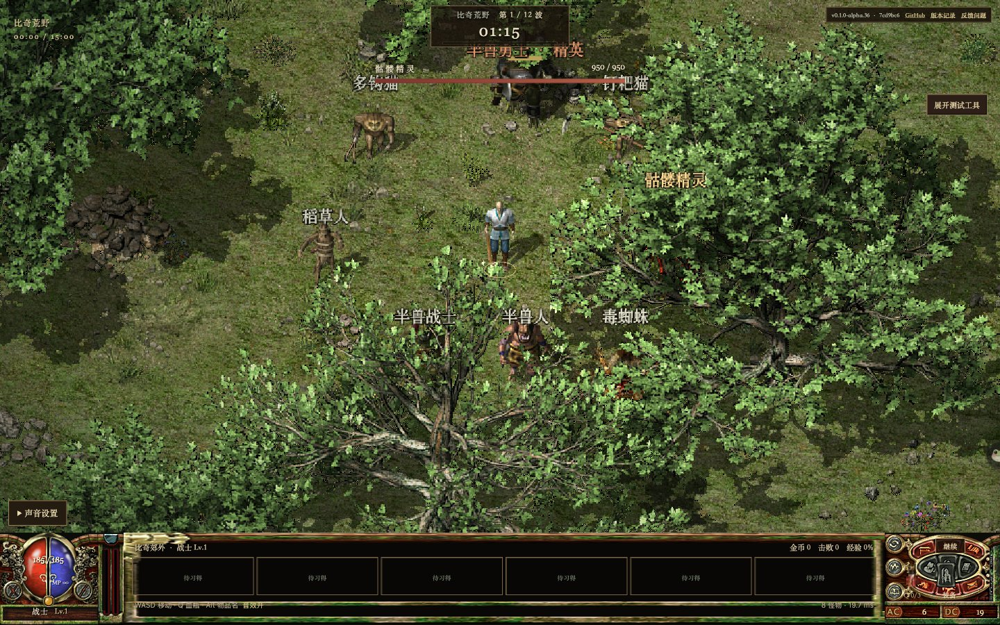
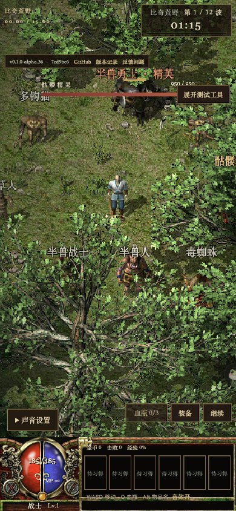

<p align="right"><a href="README.en.md">English</a></p>

<p align="center">
  
</p>

<p align="center">
  <a href="https://xiaosang.cc/mafa-survivor/?survivor">▶ 在线玩 · 幸存者模式</a>
  ·
  <a href="https://xiaosang.cc/mafa-survivor/">原版入口</a>
  ·
  <a href="https://github.com/holynova/mafa-survivor">GitHub 仓库</a>
</p>

玛法幸存者是一款手机优先的网页幸存者游戏：战法道三职业、33 种技能八级成长、10 张地图、技能进化与装备构筑。一局 20 分钟、12 波怪潮，撑到最后迎战最终首领。当前版本 v0.1.0-alpha.42，仍为 Alpha：完整职业 / 章节平衡与设备性能待完善。

## 截图

<p align="center">
  
  
</p>

> 截图为 alpha.36 版本实机画面，当前版本为 alpha.42，界面细节可能有变化。

## 玩法

- **一局 20 分钟**：1200 秒、12 波怪潮（每 100 秒一波）；精英从第 2 分钟起出现，首领在第 5 分钟登场，最终首领在最后阶段。
- **三职业**：法师（HP 100，远程施法 · 范围压制，起始火球）、道士（HP 135，符毒牵制 · 治疗召唤，起始火符）、战士（HP 185，近身挥砍 · 强韧突围，幸存者模式起始半月）。
- **33 种技能，八级成长**：1–6 级为基础成长，7–8 级按技能定位特化（如火球 7 级弹速 +20%、8 级最多 4 发）；6 级后（第 6 波起）才能升满。
- **技能进化（9 条配方）**：技能满 8 级 + 持有对应护符 + 开进化宝箱，即可进化（如火球 → 爆裂火球，命中爆炸溅射；雷电 → 雷霆连锁，最多跳 4 敌）。8 分钟后精英 / 首领掉落的宝箱才能进化；每击败两只精英获得一个宝箱，阶段首领必掉。
- **10 种护符**：火焰戒指、锋锐戒指、灵魂项链、疾风项链、广域护符、长生手镯、拾取护符、鹰眼戒指、疾行靴、回春戒指——既是属性加成，也是进化配方材料。
- **10 张地图**：章节在局外用玛法水晶解锁（0–27 颗），每张有专属怪物池与首领。
- **装备构筑**：局内掉落与商店装备、药水（红蓝药、太阳水），搭配技能与护符成型。
- **双模式**：幸存者模式（`?survivor`）与原版入口并存，存档相互独立；另有快速测试模式与测试工具面板。

## 地图

| 地图 | 首领 | 解锁（玛法水晶） |
| :--- | :--- | :---: |
| 比奇郊外 | 半兽勇士 | 0 |
| 矿洞与骷髅洞 | 尸王 | 3 |
| 沃玛神殿 | 沃玛教主 | 6 |
| 祖玛神殿 | 祖玛教主 | 9 |
| 盟重土城 | 霸王教主 | 12 |
| 蜈蚣洞 | 触龙神 | 15 |
| 石阁地宫 | 白野猪 | 18 |
| 赤月山谷 | 赤月恶魔 | 21 |
| 白日门 | 赤月恶魔 | 24 |
| 石墓一层 | 白野猪 | 27 |

## 技能（33 种，按职业）

- **法师（14）**：火球术、雷电术、火墙、魔法盾、抗拒火环、地狱火、大火球、瞬息移动、爆裂火焰、疾光电影、地狱雷光、圣言术、冰咆哮、诱惑之光。
- **战士（6）**：基本剑术、攻杀剑术、刺杀剑术、半月弯刀、野蛮冲撞、烈火剑法。
- **道士（13）**：治愈术、精神力战法、施毒术、灵魂火符、召唤骷髅、隐身术、集体隐身术、幽灵盾、神圣战甲术、心灵启示、困魔咒、群体治疗术、召唤神兽。

## 本地运行

Phaser + React + TypeScript + Vite；素材需先导入（原版图片、地图及 WAV，来源已登记）：

```sh
npm ci
python3 -m venv .venv
.venv/bin/pip install -r tools/requirements.txt
.venv/bin/python tools/import-assets.py
npm run dev
```

检查与测试：`npm test`（vitest）、`npm run build`（类型检查 + 构建）。开发说明见 [docs/DEVELOPMENT.md](docs/DEVELOPMENT.md)，进度见 [docs/STATUS.md](docs/STATUS.md)，验收标准见 [docs/ACCEPTANCE.md](docs/ACCEPTANCE.md)。

## 技术

- Phaser 3.90（游戏渲染）+ React 19（UI）+ TypeScript 5.9 + Vite 7 + zod（数据校验）+ idb（存档）。
- 数值与内容集中在 `src/content.ts`（地图 / 装备 / 怪物）、`src/spells.ts`（33 技能定义）、`src/skill-growth.ts`（1–6 级成长）、`src/survivor-growth.ts`（7–8 级特化）、`src/survivor-evolutions.ts`（9 条进化配方）。
- 素材：使用已登记的原版图片、地图及 WAV（来源与项目方授权见 `docs/asset-authorization.json`，mir2x_res 许可证见 `docs/licenses/`）。

```
index.html                  入口
src/main.tsx                React 入口
src/App.tsx                 原版模式应用
src/SurvivorApp.tsx         幸存者模式应用
src/game.ts                 游戏核心（战斗 / 波次 / 存档）
src/renderer.ts             Phaser 渲染
src/content.ts              地图 / 装备 / 怪物 / 数值
src/spells.ts               33 技能定义
src/skill-growth.ts         技能 1–6 级成长
src/survivor-growth.ts      技能 7–8 级特化
src/survivor-evolutions.ts  9 条进化配方
src/survivor.ts             幸存者模式规则（20 分钟 / 12 波 / 精英与首领）
src/classes.ts              三职业数值
tools/import-assets.py      素材导入脚本
```
