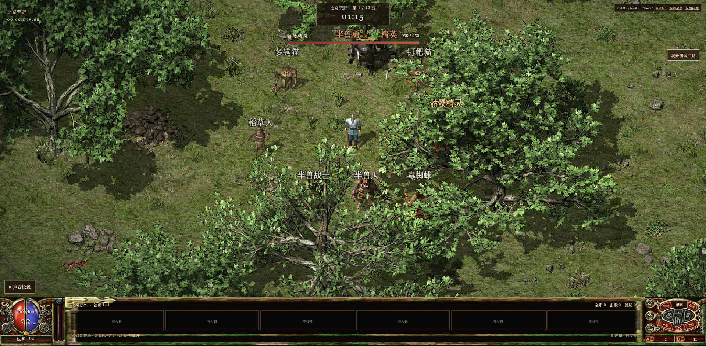

# 玛法幸存者 / Mafa Survivor

网页单机幸存者游戏：法师、战士、道士，33种技能的六级成长、十章地图、装备商店与召唤构筑。使用已登记的原版图片、地图及WAV；提供快速测试模式。当前仍为Alpha，完整职业／章节平衡与设备性能待完善。

A browser survivor game with three classes, 33 skills with six ranks, ten chapters, equipment shops and summons. Built with Phaser, TypeScript, React and Vite. Original media have recorded sources and project-owner authorization. This is an alpha: full class/chapter balance and device performance remain unfinished.



- [Cloudflare Demo（待上线验证 / pending verification）](https://xiaosang.cc/mafa-survivor/)
- [GitHub Repo](https://github.com/holynova/mafa-survivor)
- [GitHub Pages 回退 / fallback](https://holynova.github.io/mafa-survivor/)
- [开发说明 / Development](docs/DEVELOPMENT.md) · [进度 / Status](docs/STATUS.md)


## 本地运行 / Run locally

```sh
npm ci
python3 -m venv .venv
.venv/bin/pip install -r tools/requirements.txt
.venv/bin/python tools/import-assets.py
npm run dev
```

## 检查与发布 / Check and deploy

```sh
npm test
npm run deploy:prepare
# Check, commit and push the generated subtree on portfolio master.
npm run deploy:check
npm run deploy
```

Cloudflare Worker: `xiaosang-portfolio` · Path: `/mafa-survivor/`.

项目从干净`main`构建，产物在作品集`master`提交后手动发布；Git推送不会发布Cloudflare。旧Pages保留回退，本次不维护双平台同步。发布记录见[Cloudflare说明](docs/CLOUDFLARE.md)。

Build from clean project `main`, commit the generated subtree on portfolio `master`, then deploy the existing Worker locally. Set `PORTFOLIO_DIR` if the portfolio is not a sibling checkout. Git push does not deploy Cloudflare. Existing Pages remains a fallback. See the [deployment notes](docs/CLOUDFLARE.md).
